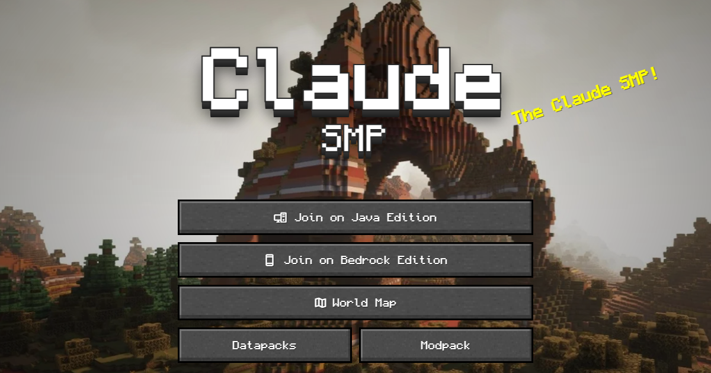
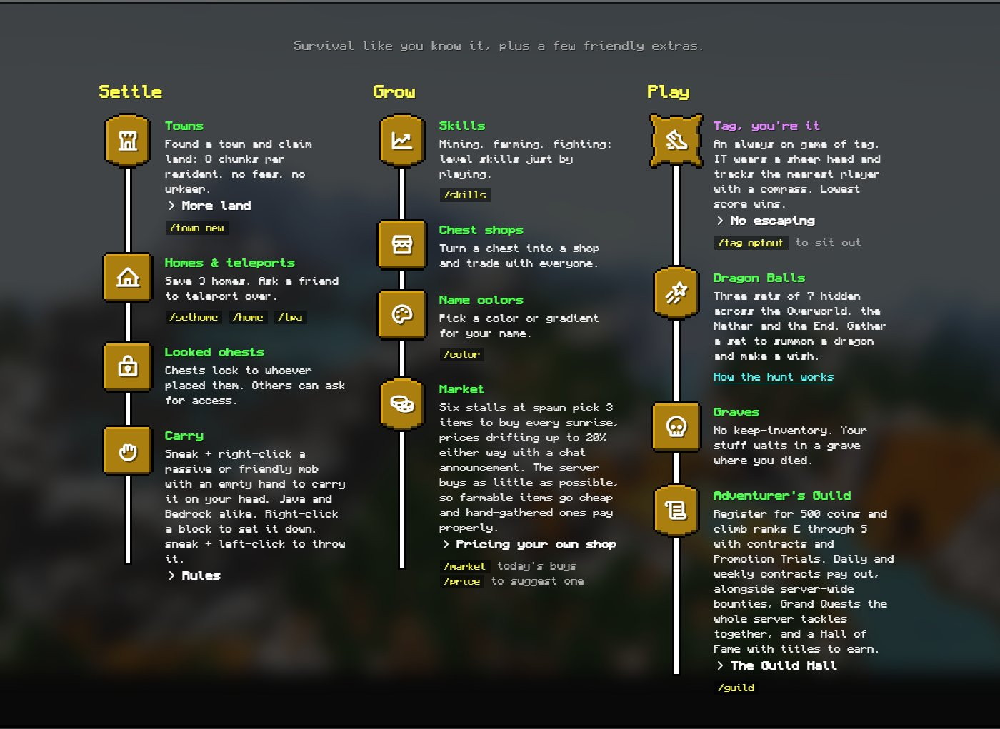
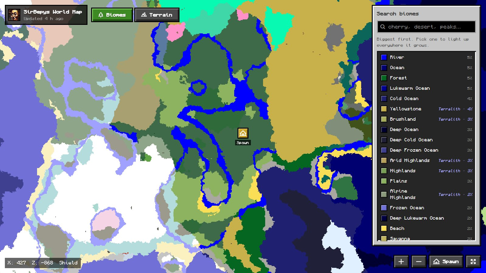

<p align="center">
  <a href="https://sirbepy.github.io/sirbepys-minecraft-server/"></a>
</p>

<h3 align="center">Every plugin, datapack and mod behind the Claude SMP, a friends survival server for Java and Bedrock.</h3>

<p align="center">
  <a href="https://sirbepy.github.io/sirbepys-minecraft-server/"><b>Website</b></a> ·
  <a href="https://sirbepy.github.io/sirbepys-minecraft-server/map/"><b>World map</b></a> ·
  <a href="https://sirbepy.github.io/sirbepys-minecraft-server/java/"><b>Join on Java</b></a> ·
  <a href="https://sirbepy.github.io/sirbepys-minecraft-server/bedrock/"><b>Join on Bedrock</b></a> ·
  <a href="client/README.md"><b>Modpack</b></a>
</p>

<p align="center">
  
  
  
  
  
</p>

<p align="center">
  
</p>

---

## What is this

The Claude SMP is survival like you know it, plus a pile of friendly extras: towns, a spawn market
that changes every sunrise, an always-on game of tag, RPG classes, Dragon Ball hunts that grant
real wishes, and bosses waiting at the End. Java players join directly, Bedrock players join
through Geyser, and an optional modpack adds shaders, voice chat and a talent tree screen.

This repo holds all of it: one Gradle build with a module per plugin, the datapacks, the client
modpack, the server assembly and deploy tooling, and the bot-driven end-to-end tests.

**Join:** `sirbepy.mcserver.host` on Java. Bedrock and full setup steps are on the
[website](https://sirbepy.github.io/sirbepys-minecraft-server/).

<p align="center">
  
</p>

## The plugins

| | Plugin | What it does | Try it |
|:-:|---|---|---|
| ☣️ | **[Tag](tag/)** | A server-wide game of tag that never stops. Get tagged, chase everyone else, climb the lowest-score-wins leaderboard. | `/tag top` |
| 🐲 | **[DragonBalls](dragonballs/)** | Hunt all 7 Dragon Balls of a set across the Overworld, Nether or End, summon the dragon and make a real, server-changing wish. | `/dragonballs status` |
| 🛒 | **[Market](market/)** | Spawn market stalls with daily rotating buyers, a Wanted board and Cosmetic Tokens for your own custom item looks. | `/market` |
| 🎭 | **[Classes](classes/)** | Pick one of 7 RPG classes, level it to 25, spend points in a talent tree and cast real abilities. | `/class tree` |
| ⚔️ | **[Guild](guild/)** | The Adventurer's Guild: daily and weekly contracts, server-wide bounties and ranks from E to S. | `/guild` |
| 🏰 | **[EndFight](endfight/)** | An illager cult fortress built around the End's pillars, standing between you and the dragon. | `/endfight status` |
| 👹 | **[Minibosses](minibosses/)** | The Sentinel, the Tyrant and the Sovereign, world bosses hidden across the map with unique loot. | explore |
| 🧜 | **[Merfolk](merfolk/)** | Turn villagers into merfolk with a nautilus shell and found a kingdom under the waves. | `/merfolk beds` |
| 📱 | **[Cartel](cartel/)** | A phone that calls in two cousins as bodyguards, or sends them after a rival. | right-click |
| 🌸 | **[Haru](haru/)** | A merchant and quest giver at the Sakura Sanctuary. | `/haru` |
| 🐑 | **[Carry](carry/)** | Sneak + right-click to pick up a mob and carry it on your head, no mods needed, Java and Bedrock alike. | sneak + click |
| 🔐 | **[SafeChests](safechests/)** | Chests lock to whoever placed them. Others knock, and the owner taps Allow or Deny in chat. | `/safe-chests-pending` |
| 🎨 | **[Names](names/)** | Name colors and gradients, nicknames, and the tag marker over IT's head. | `/color` |
| 💬 | **[ClaudeBridge](claudebridge/)** | Talk to Claude from in-game chat and get an answer back. | `/shenron <message>` |
| 🔧 | **[Tweaks](tweaks/)** | Small fixes that add up: tridents come home, restart countdowns you can push back, spawn protection that still lets signs work. | `/changelog` |

<details>
<summary><b>Infrastructure modules</b></summary>

| Module | Role |
|---|---|
| [`core`](core/) | Shared library (economy, Bedrock forms, helpers), shaded and relocated into every plugin. |
| [`treemod`](treemod/) | Fabric client mod: the clickable talent tree and ability binds for Classes. Ships in the modpack. |
| [`testserver`](testserver/) | Boots a local Paper server with every plugin and datapack for development and e2e runs. |
| [`server`](server/) | Assembles the real server folder (plugins, datapacks, config overlays) and holds the deploy tooling. |
| [`client`](client/) | The Modrinth modpack (`.mrpack`) and its resource pack. |
| [`e2e`](e2e/) | Mineflayer bots (plus a headless Bedrock client) that play through each feature on a real server. |

</details>

## The world

<p align="center">
  <a href="https://sirbepy.github.io/sirbepys-minecraft-server/map/"></a>
</p>

Worldgen is Terralith and friends. The [live map](https://sirbepy.github.io/sirbepys-minecraft-server/map/)
is built from the server's own region files every 8 hours, with a biome layer and a terrain layer.

**Datapacks** live in [`server/datapacks/`](server/datapacks/): our own (server rules, the
spawn market, performance and compatibility patches) next to pinned third-party packs (Dragonkind
Evolved, Graves, More Mob Heads, Reg's More Foods, Armor Statues and more), some ported to 26.3
here (Wither's Wrath, Backpacks!). See its
[README](server/datapacks/README.md) for the full list.

## Development

Needs JDK 25 (Gradle's toolchain resolver downloads it if missing) and Node 22 for the e2e bots.

```bash
./gradlew build                     # build and unit-test every plugin
./gradlew :testserver:runServer     # local Paper server with everything installed
./gradlew :server:assembleServer    # the deployable server folder, in server/dist/
node e2e/run-all.mjs                # bot-driven end-to-end suites
```

Unit tests use JUnit 5 and MockBukkit. The e2e suites drive real Mineflayer bots against a real
server, one script per feature in [`e2e/`](e2e/).

Design notes for each feature are in [`docs/`](docs/); [`docs/plan.md`](docs/plan.md) is the
overview and [`docs/server.md`](docs/server.md) covers hosting and deploys.

## Credits

Built on [Paper](https://papermc.io), [Geyser](https://geysermc.org) and Floodgate, with Towny,
EssentialsX, LuckPerms, AuraSkills and the datapack authors credited in
[`server/datapacks/README.md`](server/datapacks/README.md). Banner art contains a Terralith
screenshot by Stardust Labs. Font on the banner: [Monocraft](https://github.com/IdreesInc/Monocraft).

<sub>Not an official Minecraft product. Not approved by or associated with Mojang or Microsoft.</sub>
